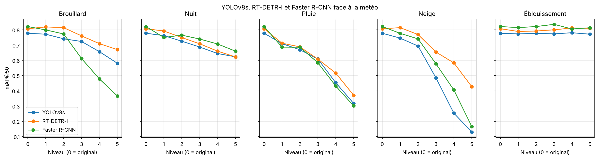
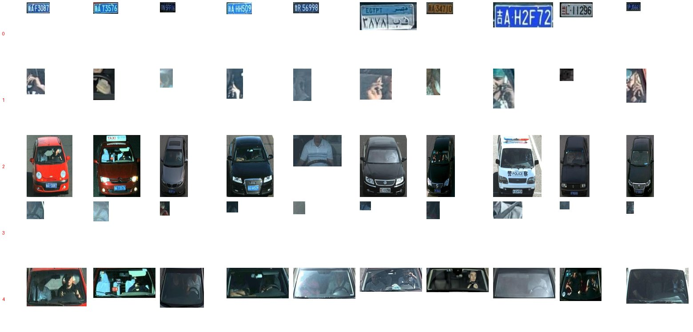

# 🌦️ Robustesse de la détection d'objets face à la météo

Une caméra de contrôle routier travaille dehors, par tous les temps. Ce projet mesure et compare **à quel point trois détecteurs d'objets entraînés par beau temps perdent leurs moyens** (YOLOv8, CNN en une étape ; Faster R-CNN, CNN en deux étapes ; RT-DETR, transformer) quand la météo se dégrade : brouillard, nuit, pluie, neige et éblouissement, chacun à 5 niveaux d'intensité.

> Projet réalisé dans le cadre de ma formation à l'ESMT Dakar, refait et documenté en 2026.

## 🎯 Problème métier
Les systèmes de vidéo-verbalisation doivent repérer le **téléphone au volant** et le **défaut de ceinture**, en plus de la plaque et du véhicule. Un modèle excellent au soleil ne sert à rien s'il devient aveugle sous la pluie. La question posée : **quelle météo, et à partir de quel niveau, rend la détection inutilisable ?**

## 📊 Données
- **500 images** de caméras de contrôle routier, vues de face, annotées en boîtes (format YOLO).
- **5 classes** : `license_plate` (plaque), `phone` (téléphone en main), `vehicle` (véhicule), `seatbelt` (ceinture), `windshield` (pare-brise).

- Chaque image a été dégradée artificiellement par **5 conditions météo × 5 niveaux**, soit **26 versions** du jeu de données (13 000 images avec l'original).
- Le jeu de données n'est pas publié dans ce dépôt (1,2 Go).

## 🧪 Protocole
1. Découpage des 500 images originales : **350 entraînement / 75 validation / 75 test** (graine 42).
2. Entraînement de trois modèles pré-entraînés sur COCO, **uniquement sur les images originales**, sur GPU T4 (Google Colab) :
   - **YOLOv8s** (Ultralytics, 11,1 M paramètres) : 50 époques, 640 px, 8 minutes.
   - **RT-DETR-l** (Ultralytics, 32,8 M paramètres) : 50 époques, 640 px, 30 minutes.
   - **Faster R-CNN** ResNet50-FPN v2 (torchvision) : 20 époques, SGD, meilleure époque choisie sur la validation, 20 minutes.
3. Évaluation de chaque modèle sur **les mêmes 75 images de test**, dans chacune des 26 conditions.
4. Métriques : **mAP@50** et **mAP@50-95**.

## 📈 Résultats

### Par temps normal

| | YOLOv8s | RT-DETR-l | Faster R-CNN |
|---|---|---|---|
| mAP@50 validation (75 images) | 0,787 | 0,781 | 0,793 |
| mAP@50 test, images originales | 0,777 | 0,807 | **0,821** |

Par beau temps, les trois modèles se tiennent en quelques centièmes.

Détail par classe en validation (mAP@50, Ultralytics) :

| Classe | YOLOv8s | RT-DETR-l |
|--------|---------|-----------|
| Pare-brise | 0,995 | 0,995 |
| Plaque | 0,988 | 0,994 |
| Véhicule | 0,747 | 0,850 |
| Téléphone | 0,691 | 0,500 |
| Ceinture | 0,516 | 0,567 |

Les petits objets (téléphone, ceinture) sont les plus difficiles.

### Face à la météo (test, mAP@50 au niveau 5, le plus extrême)

| Météo | YOLOv8s | RT-DETR-l | Faster R-CNN |
|-------|---------|-----------|--------------|
| ❄️ Neige | 0,129 (-83 %) | **0,427 (-47 %)** | 0,166 (-80 %) |
| 🌧️ Pluie | 0,317 (-59 %) | **0,371 (-54 %)** | 0,301 (-63 %) |
| 🌫️ Brouillard | 0,581 (-25 %) | **0,670 (-17 %)** | 0,366 (-55 %) |
| 🌙 Nuit | 0,623 (-20 %) | 0,622 (-23 %) | **0,660 (-20 %)** |
| ☀️ Éblouissement | 0,771 (-1 %) | 0,810 (0 %) | 0,813 (-1 %) |

Tous les niveaux, avec le mAP@50-95 : dossier [`results/`](results/).

### Le prix de la robustesse (GPU T4)

| | YOLOv8s | RT-DETR-l | Faster R-CNN |
|---|---|---|---|
| Paramètres | 11,1 M | 32,8 M | 43,3 M |
| Entraînement | 8 min | 30 min | 20 min |
| Inférence par image | ≈ 11 ms | ≈ 43 ms | ≈ 183 ms |

## 💡 Ce qu'il faut retenir
- **Le meilleur modèle par beau temps n'est pas le plus robuste.** Faster R-CNN a le meilleur score sur les images originales (0,821), mais c'est le plus fragile au brouillard (-55 %) et il s'effondre presque autant que YOLOv8 sous la neige.
- **RT-DETR est le plus robuste** à la neige, à la pluie et au brouillard. Sous forte neige, il garde **3 fois plus** de mAP@50 que YOLOv8. Une hypothèse : son attention globale (transformer) s'appuie sur le contexte de toute l'image quand les détails locaux disparaissent.
- **Faster R-CNN est le meilleur la nuit**, de peu.
- **La neige et la pluie fortes sont les pires conditions** pour les trois modèles.
- **L'éblouissement n'a aucun effet mesurable** : la perturbation générée est probablement trop légère. C'est une limite du jeu de données, pas une preuve de robustesse.
- **Le compromis vitesse/robustesse** : YOLOv8 est environ 4 fois plus rapide que RT-DETR et 16 fois plus rapide que Faster R-CNN. Pour une caméra embarquée, YOLOv8 reste le choix réaliste ; pour un traitement sur serveur par mauvais temps, RT-DETR est le plus fiable.

## ⚠️ Limites
- Jeu de test de 75 images : de petits écarts (quelques centièmes) ne sont pas significatifs.
- Le mAP de Faster R-CNN est calculé avec **torchmetrics** (protocole COCO), celui de YOLOv8 et RT-DETR avec **Ultralytics** : les méthodes sont proches mais pas identiques, la comparaison entre familles est donc indicative. Les temps d'inférence sont aussi mesurés de deux façons différentes.
- Faster R-CNN a été entraîné 20 époques (et non 50) avec un autre optimiseur, comme c'est l'usage pour ce modèle.
- Seulement **8 téléphones** en validation : le score de cette classe est fragile.
- Les dégradations sont **synthétiques**, et une seule graine d'entraînement par modèle.

## 🔜 Prochaines étapes
- Entraîner **avec augmentation météo** pour voir si YOLOv8 rattrape RT-DETR.
- Analyser la chute **par classe** sous la météo (téléphone et ceinture en particulier).
- Évaluer sur de **vraies images** de pluie et de neige.

## 🛠️ Stack
Python · Ultralytics (YOLOv8, RT-DETR) · torchvision (Faster R-CNN) · torchmetrics · PyTorch · pandas · Matplotlib · Google Colab (GPU T4)

## ▶️ Reproduire
1. Mettre le dossier du jeu de données zippé (`results.zip`) à la racine de Google Drive.
2. Ouvrir [`notebooks/robustesse_meteo.ipynb`](notebooks/robustesse_meteo.ipynb) dans Colab, choisir un GPU T4, puis exécuter les cellules dans l'ordre (sections 1 à 5 pour YOLOv8, 6 et 7 pour RT-DETR, 8 pour Faster R-CNN).

---
👩🏾‍💻 **Gnilane Faye**, élève-ingénieure IA & Data, ESMT Dakar · [LinkedIn](https://www.linkedin.com/in/gnilanefaye) · [GitHub](https://github.com/gnilanefaye)
