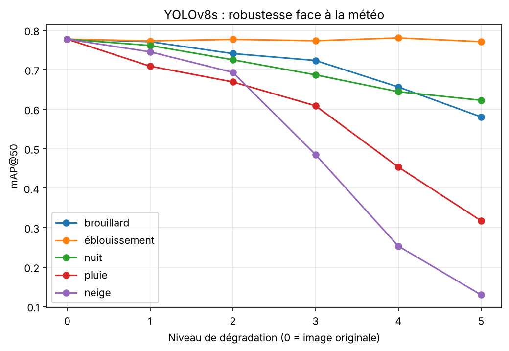

# 🌦️ Robustesse de la détection d'objets face à la météo

Une caméra de contrôle routier travaille dehors, par tous les temps. Ce projet mesure **à quel point un détecteur d'objets entraîné par beau temps perd ses moyens** quand la météo se dégrade : brouillard, nuit, pluie, neige et éblouissement, chacun à 5 niveaux d'intensité.

> Projet réalisé dans le cadre de ma formation à l'ESMT Dakar, refait et documenté en 2026.

## 🎯 Problème métier
Les systèmes de vidéo-verbalisation doivent repérer le **téléphone au volant** et le **défaut de ceinture**, en plus de la plaque et du véhicule. Un modèle excellent au soleil ne sert à rien s'il devient aveugle sous la pluie. La question posée : **quelle météo, et à partir de quel niveau, rend la détection inutilisable ?**

## 📊 Données
- **500 images** de caméras de contrôle routier, vues de face, annotées en boîtes (format YOLO).
- **5 classes** : `license_plate` (plaque), `phone` (téléphone en main), `vehicle` (véhicule), `seatbelt` (ceinture), `windshield` (pare-brise).

- Chaque image a été dégradée artificiellement par **5 conditions météo × 5 niveaux**, soit **26 versions** du jeu de données (13 000 images avec l'original).
- Le jeu de données n'est pas publié dans ce dépôt (1,2 Go).

## 🧪 Protocole
1. Découpage des 500 images originales : **350 entraînement / 75 validation / 75 test** (graine 42).
2. Entraînement de **YOLOv8s** (pré-entraîné COCO) **uniquement sur les images originales** : 50 époques, 640 px, GPU T4 (Google Colab), environ 8 minutes.
3. Évaluation du même modèle sur **les mêmes 75 images de test**, dans chacune des 26 conditions.
4. Métriques : **mAP@50** et **mAP@50-95**.

## 📈 Résultats

### Par temps normal (validation, 75 images, 232 objets)

| Classe | Précision | Rappel | mAP@50 | mAP@50-95 |
|--------|-----------|--------|--------|-----------|
| **Toutes** | 0,861 | 0,768 | **0,787** | **0,583** |
| Pare-brise | 0,981 | 0,987 | 0,995 | 0,949 |
| Plaque | 0,980 | 1,000 | 0,988 | 0,840 |
| Véhicule | 0,613 | 0,833 | 0,747 | 0,654 |
| Téléphone | 0,974 | 0,500 | 0,691 | 0,282 |
| Ceinture | 0,758 | 0,522 | 0,516 | 0,193 |

Les petits objets (téléphone, ceinture) sont les plus difficiles, même sans météo.

### Face à la météo (test, mAP@50)
Référence sans dégradation : **0,777**.

| Météo | Niv. 1 | Niv. 2 | Niv. 3 | Niv. 4 | Niv. 5 | Perte au niv. 5 |
|-------|--------|--------|--------|--------|--------|-----------------|
| ❄️ Neige | 0,745 | 0,693 | 0,485 | 0,253 | **0,129** | **-83 %** |
| 🌧️ Pluie | 0,709 | 0,669 | 0,609 | 0,453 | **0,317** | **-59 %** |
| 🌫️ Brouillard | 0,771 | 0,741 | 0,723 | 0,656 | 0,581 | -25 % |
| 🌙 Nuit | 0,762 | 0,725 | 0,687 | 0,644 | 0,623 | -20 % |
| ☀️ Éblouissement | 0,773 | 0,777 | 0,773 | 0,781 | 0,771 | -1 % |

Tableau complet (mAP@50 et mAP@50-95) : [`results/resultats_yolov8s.csv`](results/resultats_yolov8s.csv).

## 💡 Ce qu'il faut retenir
- **La neige est la pire condition** : le modèle tient jusqu'au niveau 2, puis s'effondre (-83 % au niveau 5).
- **La pluie forte** (niveaux 4-5) rend aussi la détection peu fiable.
- **Brouillard et nuit** dégradent progressivement, sans rupture brutale.
- **L'éblouissement n'a aucun effet mesurable** : la perturbation générée est probablement trop légère. C'est une limite du jeu de données, pas une preuve de robustesse.

## ⚠️ Limites
- Jeu de test de 75 images : avec seulement **8 téléphones** en validation, le score de cette classe est fragile.
- Les dégradations sont **synthétiques** : de vraies images de pluie ou de neige pourraient donner d'autres résultats.
- Une seule graine d'entraînement, pas encore de barres d'erreur.

## 🔜 Prochaines étapes
- Comparer avec d'autres architectures : **RT-DETR, Faster R-CNN, DETR**.
- Tester un entraînement **avec augmentation météo** pour voir si le modèle devient plus robuste.
- Analyser la chute **par classe** (téléphone et ceinture en particulier).

## 🛠️ Stack
Python · Ultralytics YOLOv8 · PyTorch · pandas · Matplotlib · Google Colab (GPU T4)

## ▶️ Reproduire
1. Mettre le dossier du jeu de données zippé (`results.zip`) à la racine de Google Drive.
2. Ouvrir [`notebooks/01_yolov8_robustesse_meteo.ipynb`](notebooks/01_yolov8_robustesse_meteo.ipynb) dans Colab, choisir un GPU T4, puis exécuter les cellules dans l'ordre.

---
👩🏾‍💻 **Gnilane Faye**, élève-ingénieure IA & Data, ESMT Dakar · [LinkedIn](https://www.linkedin.com/in/gnilanefaye) · [GitHub](https://github.com/gnilanefaye)
